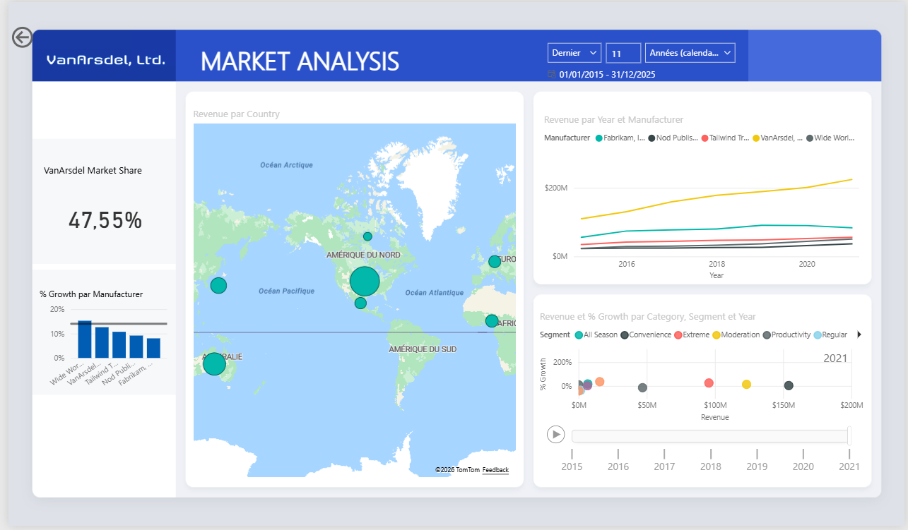
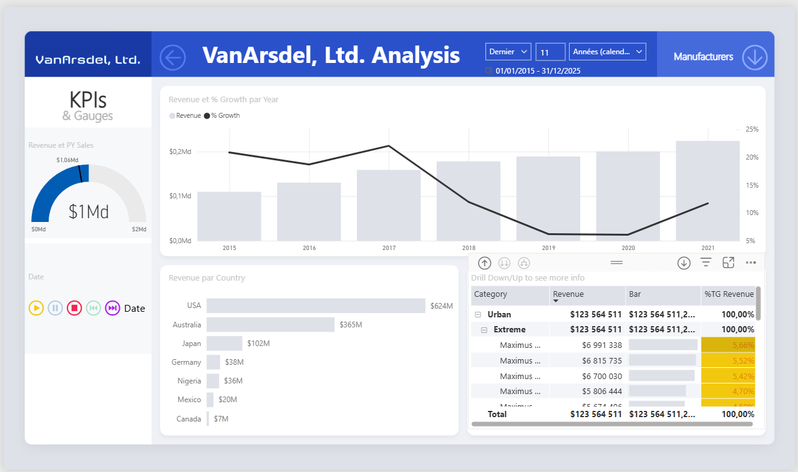

# 📊 Dashboard in a Day — Analyse des parts de marché avec Power BI

> Projet pratique réalisé dans le cadre du parcours **Microsoft Learn — Dashboard in a Day**.

## 🎯 Objectif

Explorer des données commerciales et construire un rapport interactif permettant de comparer les performances des fabricants, d'analyser les parts de marché et de suivre l'évolution des ventes.

## 🖥️ Contenu du rapport

Le fichier Power BI comprend **deux pages** :

### 1. Market Share
- Indicateur de part de marché de **VanArsdel** ;
- Comparaison des fabricants ;
- Visualisations géographiques et chronologiques ;
- Filtres interactifs et graphiques de dispersion.

### 2. By Manufacturer
- Analyse détaillée par fabricant ;
- Comparaison géographique des performances ;
- Évolution des ventes dans le temps ;
- Tableau d'analyse, jauge et filtres interactifs.

## 🛠️ Outils et compétences travaillées

- **Power BI Desktop** : conception de rapports et visualisations interactives ;
- **Analyse de données** : parts de marché, comparaisons et tendances ;
- **Modélisation et mesures** : exploration du modèle fourni dans l'atelier ;
- **Navigation** : filtres et signets du rapport.

Ce projet est un **exercice guidé Microsoft Learn** et non une mission réalisée pour une entreprise. Il reflète ma progression dans la prise en main de Power BI.

## 📊 Aperçu du tableau de bord

### Analyse des parts de marché

### Analyse par fabricant

## 📂 Fichier du projet

> **Fichier source Power BI :** le rapport `.pbix` est
> conservé localement. Les captures ci-dessus permettent
> de consulter les principaux résultats du projet.

## 🎓 Parcours de formation

[Microsoft Learn — Dashboard in a Day](https://learn.microsoft.com/fr-fr/training/paths/dashboard-in-a-day/)

---

**Auteur :** [Youmnath MOUTAIROU](https://github.com/Youmnath) · Étudiante ingénieure à ESIGELEC · IA & Big Data
